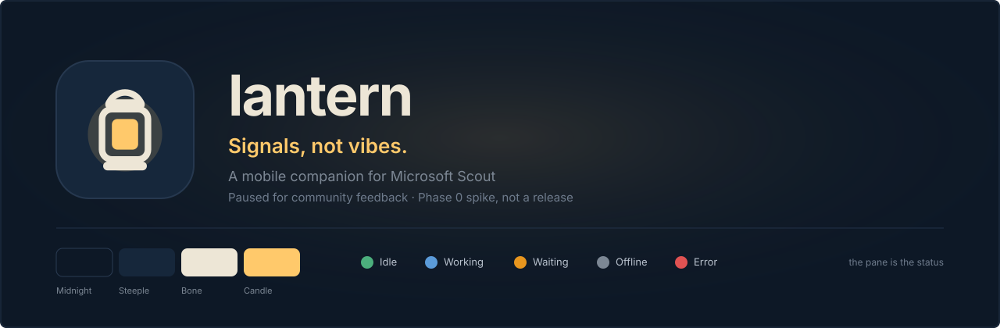
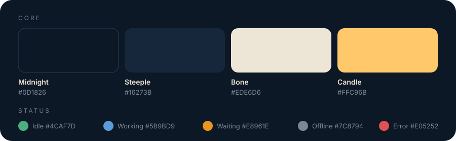
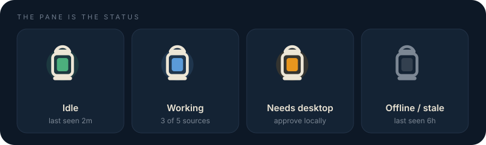
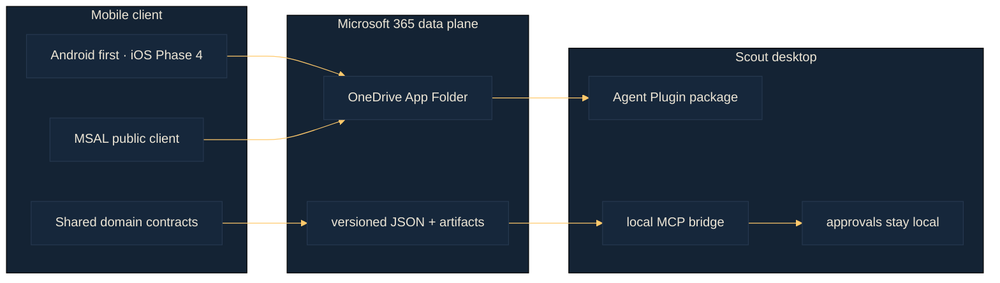

# Lantern

[](https://github.com/realactivity/scout-remote/actions/workflows/ci.yml)
[](LICENSE)
[](docs/design-spec-v2.0.md)
[](docs/community.md)



**Signals, not vibes.** A mobile companion for Microsoft Scout. The phone
checks what Scout is doing, reviews bridge-owned chats and activity, sends
bounded instructions, and reads artifacts and usage. Phone and desktop never
talk to each other. Approvals stay on the desktop.

This is an independent companion. It is not a Microsoft product and does not
imply Microsoft authorship or endorsement. The store lockup is the nominative
pattern **Lantern for Microsoft Scout**.

> [!IMPORTANT]
> **This project is paused.** Phase 0 (the Android protocol spike) is
> implemented and proven offline in CI. Phase 1 is not started. Work stays
> paused until there is community feedback on whether the App Folder command
> mailbox is the right shape — or whether we should wait for Microsoft APIs
> and swap the transport later. See [`docs/community.md`](docs/community.md)
> and open an [architecture idea](.github/ISSUE_TEMPLATE/architecture-idea.yml)
> if you have one.

> [!NOTE]
> Phase 0 is a **spike**, not a shippable app. There is no signed Play build,
> no real-tenant proof, and no interactive phone sign-in in CI. WorkManager
> and notifications are honest stubs. iOS is Phase 4.

## Logo and palette

The mark is an arched handle, a rounded body, and an inner flame. **The pane
is the status:** the flame carries state. Copy stays terse and evidence-first
("last seen 2m"), never vibes.






| Token | Name | Hex | Role |
|---|---|---|---|
| `core.midnight` | Midnight | `#0D1826` | Canvas |
| `core.steeple` | Steeple | `#16273B` | Raised surface, app-icon tile |
| `core.bone` | Bone | `#EDE6D6` | Primary text and mark |
| `core.candle` | Candle | `#FFC96B` | Accent and default flame |

| Token | Status | Hex |
|---|---|---|
| `status.idle` | Idle | `#4CAF7D` |
| `status.working` | Working | `#5B9BD9` |
| `status.waiting` | Waiting / needs desktop | `#E8961E` |
| `status.offline` | Offline / stale | `#7C8794` |
| `status.error` | Error | `#E05252` |

Authoritative sheet: [`docs/lantern-brand-sheet.svg`](docs/lantern-brand-sheet.svg).
Extracted assets: [`docs/brand/`](docs/brand/). Tokens:
[`docs/brand-tokens.json`](docs/brand-tokens.json). Guidelines:
[`docs/brand-guidelines.md`](docs/brand-guidelines.md).

## Why it is paused

The architecture works on paper and in CI: versioned JSON in the user's
OneDrive App Folder (`Files.ReadWrite.AppFolder`, `/me/drive/special/approot`).
Mobile can *request*. Desktop Scout *decides*.

Two instincts collide:

1. **The mailbox will pass commands, but it may not be elegant enough.** A
   file drop in App Folder is a least-privilege, user-owned bus. It may still
   lack the latency, presence, or product feel a companion needs.
2. **Build the product now, keep the domain interfaces, swap the transport
   later.** Spec v2.0 already says this: if Microsoft ships a native Scout
   API, replace the Graph adapter. Do not rewrite the app.

Neither instinct is proven on a real tenant or a real phone. The interesting
questions are architectural, not "please review my Kotlin." They belong to
people who work on Scout, MCP, Agent Plugins, and Graph. That is what the
pause is for. Concrete questions live in
[`docs/community.md`](docs/community.md).

## What is done, and what is not

Honest split. Details and evidence:
[`docs/status.md`](docs/status.md),
[`docs/phase0-report.md`](docs/phase0-report.md),
[`docs/enterprise-readiness.md`](docs/enterprise-readiness.md).

### Done (CI-proven, no tenant)

- Strict command inbox: schema, unknown fields, expiry, filename = `commandId`,
  prompt-injection refuse, exactly-once receipts, terminal-response
  immutability, protocol-major gate.
- Graph client shape: conditional reads (`If-None-Match` / 304), item-ID
  downloads, delta pagination + deletions + 410 reset, origin pin, 429/503
  retry with fresh bodies, bounded `Retry-After`.
- Mobile: `SyncStateStore` + Android `SqliteSyncStateStore` (SQLite metadata,
  Keystore payloads), incremental sync, content-free `LanternMetrics`.
- Desktop: Agent Plugins 1.0 package (`plugin/lantern-plugin/`), seven MCP
  tools, MSAL in an OS-protected cache (fails closed if the cache is
  unavailable).
- Brand theme: Compose tokens load from `docs/brand-tokens.json`.
- CI: SHA-pinned actions, locked restores, contracts / .NET / Kotlin /
  Android / e2e / MCP smoke.

The Agent Plugins 1.0 **package is coded** and schema-valid. Scout is **not**
a native Agent Plugins client. Install is still "copy the skill, register the
MCP server."

### Not done (human-gated or unbuilt)

- Real Entra app + Android and desktop redirects; both clients on the same
  real approot.
- Android Graph/MSAL outside the harness (`IdentityService` is a scaffold).
- WorkManager and notifications (stubs).
- Scout heartbeat / local MCP allowed by tenant policy; interactive MSAL on a
  phone.
- Signed Play build, soak, iOS (Phase 4), Mode B/C push.
- Trademark clearance and font licensing (open in the brand guidelines).

## Product boundary

Lantern is a companion to the documented Windows/macOS Scout desktop
application. It is not a replacement, and not a native Scout runtime on
mobile. The design does **not** assume

- a public API for native Scout chat, session control, enumeration, or posting
- a supported way to remotely approve Scout's sensitive actions
- that Scout natively installs Agent Plugins 1.0 packages
- any parsing or mutation of undocumented Scout databases, caches, or session
  files

Scout runs on the OpenClaw runtime. Lantern uses **only documented surfaces
(skills + MCP)**. The raw gateway, nodes, and channels are out of scope
([`docs/scout-openclaw-substrate.md`](docs/scout-openclaw-substrate.md)).

## Architecture

Asynchronous by design. OneDrive is a durable mailbox, so the phone and the
PC never need a direct network connection.



| Area | Decision |
|---|---|
| Identity | **One** Entra public-client app. Each client signs in independently with MSAL and keeps its own OS-protected token cache. Tokens never move between devices. |
| Data plane | Microsoft Graph + OneDrive **App Folder** (`Files.ReadWrite.AppFolder`). Both clients resolve `/me/drive/special/approot`. |
| Desktop bridge | Conformant Agent Plugins 1.0.0 bundle. A Scout `SKILL.md` orchestrates. A local MCP helper owns Graph auth and protocol I/O. |
| Chat | Bridge-owned conversations. Native Scout chat mirroring is a future, feature-flagged adapter. |
| Commands | ID, timestamp, **expiry**, status, auditable result. At-least-once observation, exactly-once effect. |
| Compatibility | Tolerant reader, strict writer. The inbox is the one strict gate. |
| Safety | Sensitive work returns `waiting_for_desktop_approval`. No remote bypass. Protocol text is untrusted. `requestedBy` is audit metadata, never authorization. No secrets in OneDrive JSON. |
| Mobile | Kotlin + Jetpack Compose. Graph transport is swappable. Desktop stays on .NET. `contracts/` is the language-neutral boundary. |
| Deployment | Mode A (personal, no backend) is the only current target. |

Authoritative design: [`docs/design-spec-v2.0.md`](docs/design-spec-v2.0.md).
v1.2 is historical.

## Repository layout

```
lantern/
├── docs/                          Spec, brand, status, community notes
├── contracts/                     JSON Schema + golden examples
├── src/
│   ├── shared/                    .NET protocol model + tests
│   └── mobile/                    Kotlin Gradle project
│       ├── core/                  Pure JVM. No Android APIs.
│       └── app/                   Android client (Compose). Phase 0 Home.
├── plugin/lantern-plugin/         Agent Plugins 1.0.0 package + MCP bridge
├── scripts/                       e2e, MCP, human-gated tenant kit
├── .github/workflows/ci.yml
└── LICENSE                        MIT
```

## Build and test

Requires the .NET 10 SDK (`global.json`) and JDK 17+. CI runs six jobs on
every pull request.

```bash
dotnet restore Lantern.sln --locked-mode
dotnet build Lantern.sln -c Release --no-restore
dotnet run --project src/shared/Lantern.Domain.Tests/Lantern.Domain.Tests.csproj -c Release --no-build --no-restore -- -noColor -noLogo
dotnet run --project plugin/lantern-plugin/bridge/Lantern.Bridge.Tests/Lantern.Bridge.Tests.csproj -c Release --no-build --no-restore -- -noColor -noLogo

( cd src/mobile && ./gradlew :core:build )
( cd src/mobile && ./gradlew :app:assembleDebug :app:testDebugUnitTest )

scripts/smoke-e2e/run.sh
python3 scripts/smoke-mcp/run.py
python3 contracts/validate_examples.py   # pip install jsonschema
```

Real-tenant checks are human-gated:
[`scripts/smoke-tenant/README.md`](scripts/smoke-tenant/README.md). Never
commit its `.local/` directory.

`./.cursor/install.sh` bootstraps a fresh machine. It is idempotent.

## Roadmap (unchanged, not in progress)

| Phase | Scope |
|---|---|
| 0 | Android spike. Done in code. Tenant/device still human-gated. |
| 1 | Android MVP. Home, Activity, Chats, Artifacts, Settings. Play internal test. **Not started.** |
| 2 | Usage, Work IQ budgets, diagnostics, retention. |
| 3 | Optional Azure notification service and Graph subscriptions. |
| 4 | iOS, same contracts. |
| 5 | Adapters: official Scout API, native-chat mirror, optional Dynamics 365. |
| 6 | Enterprise: admin policy, audit export, managed deployment. |

**Architecture invariant.** If Microsoft later ships first-party Scout mobile
APIs, the domain interfaces stay. Swap the transport. Do not rewrite the app.

## License

[MIT](LICENSE). The plugin package carries its own copy plus the SPDX
`license` field so it stays licensed when distributed separately.

Security reports: [`SECURITY.md`](SECURITY.md). Contribution rules, including
the pause: [`CONTRIBUTING.md`](CONTRIBUTING.md).
