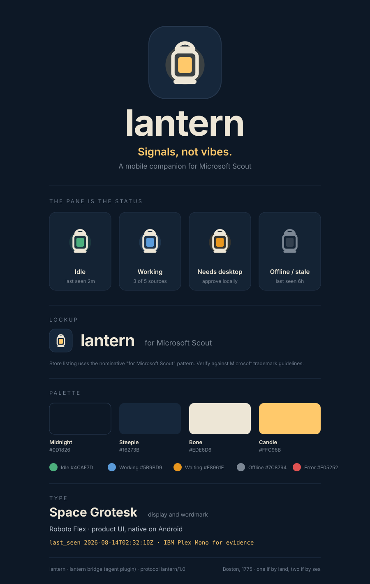

# lantern brand guidelines

Brand and UX specification for the **lantern** mobile client, the companion app
for Microsoft Scout.

> **Source of truth**
> [`lantern-brand-sheet.svg`](lantern-brand-sheet.svg) is the authoritative brand
> sheet. [`brand-tokens.json`](brand-tokens.json) is its machine-readable
> extraction, faithful to the SVG hex values, meant to back the Android Compose
> theme. This document is the human reading of both, plus the mapping from brand
> to the protocol state model so the UX is unambiguous.

## Essence and voice

- **Name** lantern (lowercase wordmark).
- **Tagline** "Signals, not vibes."
- **Descriptor** "A mobile companion for Microsoft Scout."
- **Motif** the Old North Church signal lanterns, Boston 1775, "one if by land,
  two if by sea." The product is a *signal*: a glanceable, evidence-based read on
  what Scout is doing, never a guess. Copy stays terse, factual, and calm. Prefer
  concrete evidence ("last seen 2m", "3 of 5 sources") over adjectives.
- **Guiding UX principle** **the pane is the status.** The lantern's inner pane
  (flame) carries state through color. State is shown, not narrated.

## Logo, wordmark, lockup

- **App icon** the lantern mark centered on a Steeple (`#16273B`) tile, 42 px
  corner radius at 176 px, 2 px `#26384F` stroke. The flame is Candle (`#FFC96B`).
- **Wordmark** `lantern` set in Space Grotesk 700 with tight tracking (-1 to -2).
  Always lowercase.
- **Lockup** mark + `lantern` + `for Microsoft Scout` in secondary text. Use the
  nominative "for Microsoft Scout" pattern for store listings.
- **Trademark caveat** "for Microsoft Scout" is nominative use. Verify against
  Microsoft trademark guidelines before shipping any public listing. Do not imply
  Microsoft authorship or endorsement.

## Color system

### Core palette

| Token | Name | Hex | Role |
|---|---|---|---|
| `core.midnight` | Midnight | `#0D1826` | App background / canvas |
| `core.steeple` | Steeple | `#16273B` | Raised surface, cards, app-icon tile |
| `core.bone` | Bone | `#EDE6D6` | Primary text and foreground marks |
| `core.candle` | Candle | `#FFC96B` | Brand accent, primary emphasis, flame |

Bone on Midnight is the default text pairing (high contrast on the dark canvas).
Candle is reserved for brand emphasis and the flame; it is not a text color for
long-form copy.

### Semantic status palette

Defined by the brand sheet. These are the only colors that carry state meaning.

| Token | Status | Hex |
|---|---|---|
| `status.idle` | Idle | `#4CAF7D` |
| `status.working` | Working | `#5B9BD9` |
| `status.waiting` | Waiting / Needs desktop | `#E8961E` |
| `status.offline` | Offline / stale | `#7C8794` |
| `status.error` | Error | `#E05252` |

### Support / structural tints

Present in the sheet artwork but not formally named. Kept in `brand-tokens.json`
so the theme has one source: `#142334` (card fill), `#223247` (hairlines),
`#26384F` (tile stroke), `#2A3B52` (outlined swatch), `#33404F` (muted flame),
plus text tints `#7C8794` (secondary), `#6E7B8C` (labels), `#B9C2CE` (body).

## Status system to protocol mapping

"The pane is the status" binds directly to the protocol state model. Color is
carried by the semantic tokens above; never invent new status colors.

### Defined by the brand sheet (authoritative)

| Protocol value | Type | Token |
|---|---|---|
| `idle` | `AgentState` | `status.idle` |
| `working` | `AgentState` | `status.working` |
| `waiting_for_desktop` | `AgentState` | `status.waiting` |
| `waiting_for_desktop_approval` | `CommandStatus` | `status.waiting` |
| stale overlay (`AgentStatus.isStale(...) == true`) | client-derived | `status.offline` |
| `failed` | `CommandStatus` | `status.error` |

The stale/offline state is **client-derived** from `lastSeenUtc`, never a wire
value (see `AgentStatus.isStale` and the spec's evidence-based presence rule).
`AgentState.unknown` with no recent `lastSeenUtc` renders as `status.offline`.

### Proposed, pending design sign-off

The sheet does not depict these states. Proposed mappings, to confirm before use:

| Protocol value | Type | Proposed token |
|---|---|---|
| `completed` | `CommandStatus` | `status.idle` (settled / success) |
| `acknowledged`, `running` | `CommandStatus` | `status.working` (in flight) |
| queued | client-derived | `status.working` (in flight) |
| `expired` | `CommandStatus` | `status.offline` (lapsed, non-alarming) |
| `canceled` | `CommandStatus` | `status.offline` |

Like stale/offline, "queued" is client-derived, never a wire value: a command
file in the inbox with no response file yet *is* the queued state (spec
Appendix A.1).

## Typography

| Role | Family | Notes |
|---|---|---|
| Display / wordmark | **Space Grotesk** | 700 weight, tight tracking |
| Product UI | **Roboto Flex** | Native on Android; default for screens |
| Evidence / mono | **IBM Plex Mono** | Timestamps, IDs, protocol values; shown in Candle |

Evidence values (timestamps such as `2026-08-14T02:32:10Z`, ULIDs, command IDs)
are always monospace so raw protocol data reads as data, not prose.

## Iconography

The lantern mark is an arched handle, a rounded body, and an inner flame pane.
The flame pane is the one element that changes color to encode status. For the
offline state the whole mark desaturates to `status.offline` / `#33404F`. App
icon corner radius is 42 px (at 176 px); status tiles use 14 px.

## UX adherence checklist (Phase 0 / 1 Compose)

When the Android `app` module (`src/mobile/app`) is built, the Compose theme must:

- [ ] Define color tokens from `brand-tokens.json`; do not hardcode ad-hoc hex.
- [ ] Use Midnight as the surface/background and Bone as the on-surface text.
- [ ] Drive all agent/command status affordances from the semantic status tokens
      via the mapping above; add no new status colors.
- [ ] Derive stale/offline on-device from `lastSeenUtc`; never expect it on the wire.
- [ ] Load Space Grotesk (display/wordmark), Roboto Flex (UI), IBM Plex Mono
      (evidence). Render timestamps, IDs, and protocol values in mono.
- [ ] Keep copy terse and evidence-first, matching "Signals, not vibes."
- [ ] Confirm the proposed status mappings with design before relying on them.

## Naming and positioning

**Decided.** The product ships as **Lantern**, positioned as **"Lantern for Microsoft
Scout."** This is the nominative pattern used by Apollo for Reddit and Ivory for
Mastodon: a distinct, ownable product name plus "for Microsoft Scout" as a descriptor,
never leading with Microsoft's mark. Leading with the mark ("Scout Remote") invites
Play Store rejection and a legal challenge; the nominative pattern keeps the mark as
honest descriptive use.

Why Lantern fits the architecture: Scout never connects to the phone. It hangs a light
in a shared place (`status.json`, activity, receipts) that the phone reads from across
the water. That is the Old North Church signal, April 1775: a pre-agreed protocol, a
bounded vocabulary, asynchronous, sender and receiver never directly connected. Presence
is evidence-based (spec Appendix A): a lantern is lit or it is not, so the app shows the
light and `lastSeenUtc` rather than claiming "online." The status pane (spec §9.1) is the
icon itself, which doubles as a home-screen widget.

| Surface | Name |
|---|---|
| App / product | Lantern (wordmark lowercase `lantern`) |
| Desktop bridge package | Lantern Bridge |
| Protocol identifier | `lantern/1.0` |
| GitHub repository | `realactivity/scout-remote` (unchanged; existing URLs stay valid) |

**Voice rule: timestamps over adjectives.** Prefer concrete evidence ("last seen 2m",
`lastSeenUtc`) over claims. Tagline: "Signals, not vibes."

## Open decisions

- **Trademark clearance.** "Lantern" has coexisting marks in unrelated categories (a
  censorship-circumvention VPN, a healthcare benefits navigator). Run a real clearance
  screen for the app category before public launch, and assume the bare domain is taken
  (a `lantern.build` / `uselantern.app`-style domain works). Verify "for Microsoft Scout"
  against Microsoft's current trademark guidelines. Backups if clearance fails, in order:
  **Sitrep** (literal, zero romance), **Heliograph** (most ownable, longest), **Semaphore**
  (best pun on the queue semantics, but crowded by the CI company).
- **Font licensing.** Space Grotesk, Roboto Flex, and IBM Plex Mono ship under open
  licenses (SIL OFL / Apache); confirm and vendor the exact weights during Phase 0.
